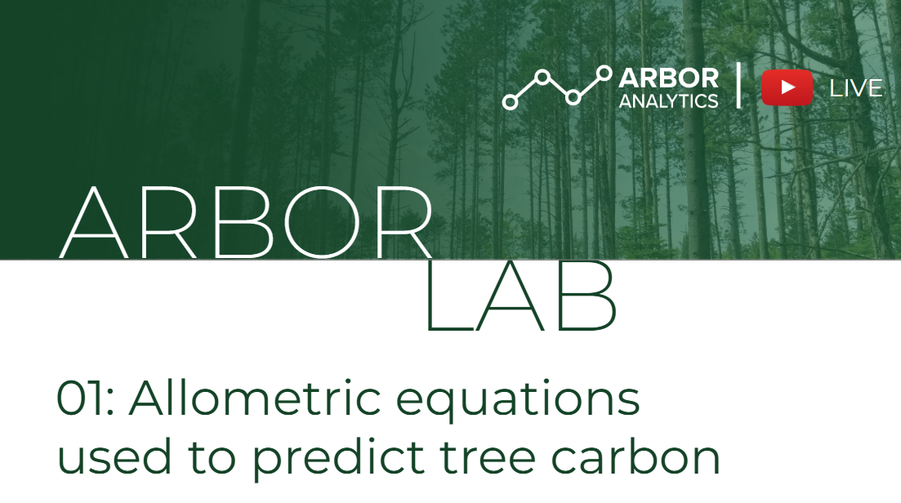

# Arbor Lab 01: Allometric equations used to predict tree carbon

This session covered the allometric equations commonly used to predict tree carbon in U.S. forests:

- **Jenkins** (Jenkins et al. 2003): generalized species-group biomass equations
- **CRM** (Component Ratio Method): The Forest Inventory and Analysis (FIA) program's former standard for tree biomass
- **NSVB** (National-Scale Volume and Biomass; Westfall et al. 2023): FIA's current standard

## Data
We used tree-level observations from New York State (see [FIA data](https://apps.fs.usda.gov/fia/datamart/datamart.html)) and compared the resulting carbon estimates.

## Running the demo
1. Open `arbor_lab_01.qmd` in RStudio or Positron.
2. Install the packages: `install.packages(c("tidyverse", "usmap", "readxl"))`.
3. Render the document.

